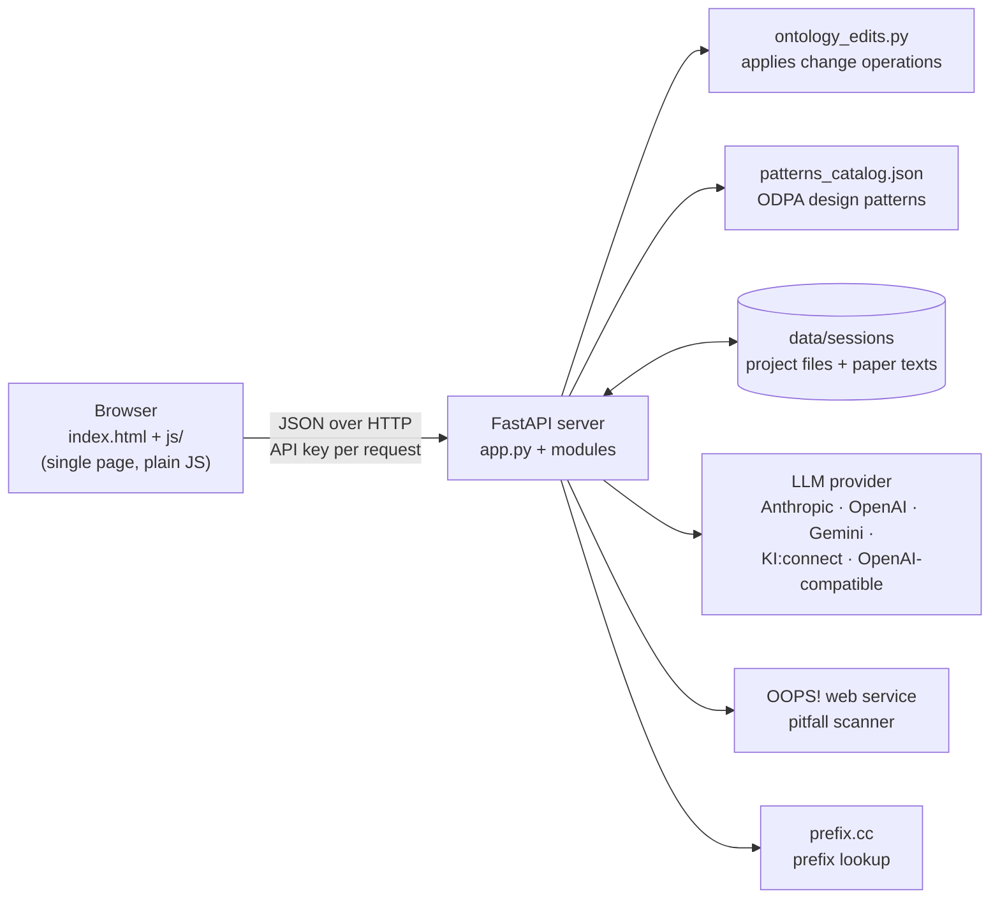

# LITMO – LITerature-driven Modular Ontologies

> **LITMO has moved.** This repository holds version 0.2 and is no longer updated. Current versions, from 0.3 on under the Apache License 2.0, are at **[github.com/Fraunhofer-FIT-DSAI/LITMO](https://github.com/Fraunhofer-FIT-DSAI/LITMO)**; please open issues there.

A web tool for building OWL ontologies with a large language model as a drafting partner. It follows the
**MOMo** (Modular Ontology Modeling) methodology of Shimizu, Hammar & Hitzler, so the ontology is built
conceptually first (use case, competency questions, key notions, design patterns) and the OWL file comes last.
The model proposes; the team decides at every step.

What the tool can do:

- **Guided workflow**: eight steps from use case to OWL file, each with model suggestions you can accept, edit or discard.
- **Literature-based ontologies**: read dozens of papers one by one, merge their concepts into an inventory with
  conflicting definitions and candidate modules. Existing ontologies and concept tables can be added to the same
  inventory.
- **Module-by-module generation**: each class records the papers it is based on (`dct:source`).
- **Checks on every result**:
  - Turtle syntax
  - the [OOPS!](https://oops.linkeddata.es/) pitfall scanner, with automatic fixes
  - competency questions run as SPARQL tests against sample data
- **Iterative refinement in plain language**: the model returns precise changes and the server applies them,
  so nothing you did not ask for changes.
- **Projects are saved on the server**: they can be exported and imported as a single file.

Supported LLM providers: Anthropic (Claude), OpenAI, Google Gemini, RWTHgpt / KI:connect, and any
OpenAI-compatible endpoint.

**Contents:** [Quick start](#quick-start) · [Deployment](#deployment) · [Architecture](#architecture) ·
[User manual](#user-manual) · [Troubleshooting](#troubleshooting) · [Further documentation](#further-documentation)

---

## Quick start

On Windows, double-click **`start.bat`**. It:

1. creates a Python environment in `.venv` (on first start)
2. installs the dependencies
3. starts the server

Then open **http://localhost:8000/app**. Keep the window open while you work. If a server is already running,
`start.bat` only opens the browser.

You need an API key for one of the supported providers. You enter it in step 1 of the tool.

---

## Deployment

### Requirements

- **Python 3.** Developed and tested with 3.14; other versions have not been tested.
- **Java** (optional, any current JDK/JRE), for the HermiT reasoner in the evaluation. Without Java the reasoner
  check is skipped; everything else works.
- **Network access** from the machine running the server to:
  - your LLM provider (e.g. `api.anthropic.com`, `api.openai.com`, `generativelanguage.googleapis.com`,
    `chat.kiconnect.nrw`)
  - `oops.linkeddata.es`, for the quality check
  - `prefix.cc`, to look up prefixes you add yourself
- A modern browser. The tool uses no build step and loads a graph library (vis.js) from a CDN.

### Installation

**Windows:** run `start.bat` (see above).

**Manually (Windows, macOS, Linux):**

```bash
python -m venv .venv
.venv/bin/pip install -r requirements.txt        # Windows: .venv\Scripts\pip install -r requirements.txt
.venv/bin/python -m uvicorn app:app --port 8000  # Windows: .venv\Scripts\python -m uvicorn app:app --port 8000
```

Then open http://localhost:8000/app. The page at http://localhost:8000/ describes the tool and the methodology.

Run the server in its own terminal window. A long generation can take several minutes, and the run is lost if the
server process stops.

### Configuration

| Setting | Default | Purpose |
|---|---|---|
| `ODT_SESSION_DIR` (environment variable) | `data/sessions` next to `app.py` | Where projects are stored |
| `--port` (uvicorn) | 8000 | Server port |
| `--host` (uvicorn) | `127.0.0.1` | Only reachable from this machine; see [Running for a team](#running-for-a-team) |

**API keys** are entered in the browser and sent with each request. They are **never stored** on the server, in
project files or in exports. After reloading the page you enter the key again. For RWTHgpt / KI:connect the
server can hold a key for everyone who uses it: set the environment variable `LITMO_RWTHGPT_KEY` before starting it
(on Windows `set LITMO_RWTHGPT_KEY=...` in the window that runs `start.bat`). Step 1 then accepts an empty key field;
the key stays on the server and never reaches the browser.

### Data and backups

| What | Where |
|---|---|
| Projects (sessions) | `data/sessions/<id>.json`, written after every change |
| Full texts of uploaded papers and tables | `data/sessions/<id>/corpus/` |

`data/` is excluded from git, because it contains your uploaded documents.

- **Back up:** copy `data/`, or use **⬇ Export** in the tool. That gives one `*.project.json` file including the
  paper texts.
- **Move a project:** export it, then use **⬆ Import** on the other machine.
- **Clean up:** old projects are never deleted automatically. Delete their files in `data/sessions/` while the
  server is stopped.

### Running for a team

The tool is built for **one user per server**:

- **No login.** Anyone who can reach the port can open every project.
- **No locking.** Two people working on the same project overwrite each other's changes.
- **One process.** Projects are held in the memory of that process. Do not start uvicorn with `--workers` greater
  than 1.

If several people need it, the simplest way is that **each runs their own copy** on their computer. To host one
instance on a server anyway:

- put it behind a reverse proxy with authentication and HTTPS
- bind uvicorn to `127.0.0.1` and let only the proxy reach it

Never start it with `--host 0.0.0.0` on an open network. The server sends no CORS headers, so other web pages in
the same browser cannot read or change the projects (DECISIONS 117).

### Security notes

- **No credentials in the code.** Earlier versions of the private development repository contained an RWTHgpt key
  and a GitHub token; both were revoked, and the public repository starts from a cleaned state (DECISIONS 139).
- **Uploaded documents are sent to the LLM provider you choose.** Do not upload anything your provider agreement
  does not cover.
- **Ontologies are sent to OOPS!** The Turtle of every generated ontology goes to `oops.linkeddata.es` for the
  quality check.

### Updating the design-pattern catalog

`patterns_catalog.json` is a snapshot of the [ODPA patterns repository](https://github.com/odpa/patterns-repository):

```bash
git clone --depth 1 https://github.com/odpa/patterns-repository odpa
python tools/build_pattern_catalog.py odpa
```

### Tests

```bash
pip install -r requirements-dev.txt
pytest                              # all tests; the reasoner tests are skipped without Java
pytest tests/test_actions.py        # one file
pytest -k upper                     # the tests whose name contains "upper"
```

The tests are grouped by topic: `test_ontology_edits`, `test_edit_flow` (feedback, OOPS! fix, Turtle editor),
`test_generation`, `test_definitions`, `test_literature`, `test_vocabularies`, `test_actions` (the improvement actions),
`test_cq_testing`, `test_evaluation`, `test_turtle_export`, `test_documentation`, `test_projects`, `test_llm` and `test_tools` (the measurement scripts).
Shared helpers (the example ontology `base()`, the simulated model `FakeLLM`) are in `tests/helpers.py`;
`tests/conftest.py` keeps the sessions in a temporary folder and restores every function a test replaces, so the
tests do not depend on their order. To check that, install `pytest-randomly` and run `pytest` a few times.

The tests use a scripted stand-in for the LLM. They need no API key and no network.

---

## Architecture



### Components

| File | Role |
|---|---|
| `app.py` | FastAPI backend: the endpoints. The logic lives in the modules listed below. |
| `ontology_edits.py` | Applies and validates the change operations the model returns, renames invalid identifiers, and produces the compact ontology listing for prompts. It has no web dependencies. |
| `ontology_evaluation.py` | Evaluation measures: CQ coverage levels, hold-out selection, inventory coverage, traceability, structural metrics, HermiT reasoner check (child process). No web dependencies. |
| `index.html` | The user interface: one page with no build step - markup and styles. |
| `js/` | Its JavaScript, one file per step (`step1-llm.js` … `step9-refine.js`), shared code in `core.js` and `project.js`; `main.js` loads last and starts the page. Plain scripts: every function is global, so the `onclick` handlers in the markup reach them. |
| `landing.html` | Introduction to the tool and to MOMo, served at `/`. |
| `patterns_catalog.json` | 126 ontology design patterns with their classes and properties; `tools/build_pattern_catalog.py` builds it. |
| `start.bat` | Windows launcher (venv, dependencies, server). |
| `tests/` | Tests for the edit operations, the feedback/fix flow and the evaluation and improvement actions. |
| `DEVELOPMENT.md`, `DECISIONS.md`, `EVALUATION.md` | Detailed technical description, the design decisions with their reasons, and how ontologies are evaluated (literature and the built-in measures). |

### How the backend is organised

`app.py` holds only the endpoints; the logic is split into modules (DECISIONS 82). Imports go one way, from top to
bottom of this list:

| Module | Contents |
|---|---|
| `store.py` | Sessions in memory and their JSON files |
| `llm.py` | Model calls, provider errors, token usage, reading JSON answers |
| `project.py` | Project context, conventions, ODP catalog |
| `definitions.py` | Decided definitions of conflicting concepts: decisions, recommendations, planning, check, repair |
| `ontology_io.py` | JSON model ↔ Turtle/RDF, prefixes, syntax check, SHACL |
| `corpus.py` | Use-case data files, literature corpus, paper cards, concept inventory |
| `momo_steps.py` | Prompts of the steps before generation: context draft, CQs, key notions, patterns, review |
| `vocabularies.py` | Standards and vocabularies: suggestion, loading, reuse in generation, alignment candidates |
| `editing.py` | Edit operations through the model, provenance guard, OOPS!, Turtle correction |
| `testing.py` | Competency questions as SPARQL tests |
| `generation.py` | Planning, modules, merge |
| `relations.py` | Core relations: proposal before generation (step 7), checks, use in the merge |
| `upper.py` | Upper layer: configuration, creation in the generation and the repair, removal of empty upper classes |
| `improvements.py` | Core relations (consolidation), improvement packages, decisions, reasoner guard |
| `documentation.py` | Documentation export: one chapter per module, as Markdown or HTML, without model calls |

Tests that replace the model set `llm.call_llm`; every module calls it as `llm.call_llm(...)` for that reason.

What the backend does:

| Area | What it does |
|---|---|
| **Persistence** | One JSON file per project. A middleware saves every project that changed after each modifying request. |
| **LLM calls** (`call_llm`) | One function for all providers. Anthropic calls are streamed with a large output budget. An answer cut off at the limit is reported as an error, not parsed. Token usage is logged per step and shown in the UI. |
| **File analysis** | Tables are profiled over all rows. PDFs and text are read in full. RDF files are summarised. |
| **Project context** | A Markdown document plus conventions (namespace, prefix, label languages, license, OWL profile). They are passed to every later prompt; namespace, prefix and license are enforced on the output. |
| **Literature corpus** | Each paper becomes a *paper card*: concepts with definition, page and verified quote, plus relations, taxonomies, candidate questions and vocabularies. Existing ontologies and concept tables become cards without a model call. All cards merge into a *concept inventory*. |
| **MOMo steps** | Prompts and endpoints for competency questions, key notions, design patterns and standards. |
| **Generation** | One path for every project: a planning call fixes the classes of each module (with an inventory from its concepts, without one from the use case, the competency questions and the data; without key notions it also proposes the modules), one call per module runs in parallel, and the server merges the results. |
| **Changing the ontology** | Feedback rounds and automatic fixes do not regenerate the ontology. The model returns *operations* (add, update, rename, remove …); `ontology_edits.py` applies them and rejects anything that would break the ontology. |
| **Quality checks** | Turtle syntax (rdflib), OOPS! with automatic fixes for critical and important pitfalls, and competency questions as SPARQL tests evaluated by rdflib. The **evaluation** (`/api/evaluate`) adds hold-out questions from the literature, inventory coverage, traceability, structural metrics and the HermiT reasoner. **Evaluate 3x** tests the questions three times from scratch and reports the mean and spread, since a single test varies by up to 2 of 10 questions. |
| **Turtle export** | The internal JSON model is written out as OWL in Turtle, with OPLa module annotations, labels per language, `dct:source` and `rdfs:seeAlso`. |

### Data model

The ontology is kept as JSON and serialized to Turtle on demand:

```json
{
  "ontology_name": "…", "namespace": "https://example.org/onto#", "license": "https://…", "summary": "…",
  "modules":     [{"name": "Task", "key_notion": "Task", "pattern": "PatternID or null", "documentation": "…"}],
  "classes":     [{"name": "LowLevelTask", "labels": {"en": "…", "de": "…"}, "description": "…",
                   "parent": "Task", "module": "Task", "sources": ["Author, 2014: Title"], "see_also": ["https://…"]}],
  "properties":  [{"name": "usesData", "type": "ObjectProperty", "domain": "Task", "range": "Dataset",
                   "inverse_of": "usedByTask", "labels": {"en": "…"}, "description": "…", "module": "Task"}],
  "individuals": [{"name": "…", "class": "…", "labels": {"en": "…"}}],
  "axioms":      [{"type": "DisjointClasses", "classes": ["A", "B"], "module": "…", "scoped": true}]
}
```

A project file (`data/sessions/<id>.json`) holds:

| Key | Content |
|---|---|
| `momo` | Use case, competency questions, key notions, patterns |
| `context` | Project context document, conventions, open questions |
| `corpus` | Sources, paper cards, concept inventory |
| `data_files` | Analyzed step-2 uploads |
| `ontology` | The ontology itself |
| `feedback_log` | Recent change requests |
| `ui` | Interface state (current step, reports, token usage) |

### API overview

All endpoints are under `/api` and return JSON. Endpoints that call a model take an `llm_config`
(`provider`, `api_key`, `model`, `base_url`).

| Area | Endpoints |
|---|---|
| Projects | `POST session/create`, `GET session/{id}`, `POST session/ui`, `GET session/{id}/export`, `POST session/import` |
| Step 2: data | `POST upload`, `POST load-ontology` |
| Step 3: literature | `POST corpus/upload`, `POST corpus/extract` (one paper per call), `POST corpus/map-columns`, `POST corpus/remove`, `POST corpus/inventory` |
| Step 4: context | `POST context/upload`, `POST context/draft`, `POST context/answer`, `POST context/save` |
| Steps 5–7: MOMo | `POST momo/save`, `POST momo/suggest-cqs`, `POST momo/suggest-notions`, `POST momo/suggest-patterns`, `GET patterns`, `POST suggest-standards` |
| Steps 8 and 9: generation, evaluation and refinement | `POST generate`, `POST feedback`, `POST upload-feedback-files`, `POST momo/test-cqs`, `POST evaluate`, `POST gaps/start`, `POST gaps/step`, `POST gaps/finish`, `POST export`, `POST generate-shacl`, `POST update-turtle`, `POST fix-turtle` |
| Prefixes and models | `GET resolve-prefix`, `POST session/add-prefix`, `DELETE session/remove-prefix`, `POST models` |

Responses of endpoints that call a model include a `usage` block (tokens per step). The paper extraction is
driven by the browser, one paper per request and three in parallel. The server therefore needs no background jobs,
and the API key never has to be stored.

---

## User manual

The sidebar shows the eight steps. You can move between them freely. Everything is saved automatically, and after
reloading the page, or restarting the server, the tool reopens your project.

The header shows the open project, its iteration and the model:

- **The project name** lists all saved projects, last changed first, with iteration, size and date. **Open** switches
  to one; **✎ Rename** gives it its own title (useful for copies of the same project, which share the ontology name).
- **The model** reads "key needed" after reloading a project: the API key is never stored, so enter it again in step 1.
- **The sun / moon button** switches between a light and a dark theme; without a choice the page follows the
  system setting.
- **New project** starts an empty project; the current one stays saved. **Export project** downloads the whole
  project as one file; **Import** opens an exported project file as a new project.

The sidebar shows each step's state at a glance: the number of sources, questions and key notions, undecided
definition conflicts, core relations to review, an outdated evaluation.

### 1 · Model and key

Choose a provider and a model, and enter your API key (**Show** reveals it while typing). For RWTHgpt the available models are read from KI:connect.
**Custom** accepts any OpenAI-compatible endpoint (base URL plus model name).

Larger models give better ontologies. The literature extraction in step 3 runs once per paper, so the cost grows
with the corpus.

### 2 · Use case and data

Two ways to start: **Describe the domain** (the steps below) or **Start from an existing ontology**.

- **Use case**: describe the problem *deliberately loosely*. A paragraph is enough; related use cases and future
  extensions may be included.
- **Data sources**: which databases, files or websites the ontology must represent.
- **Special requirements** (optional): anything the model should always respect.
- **Upload**: data files the ontology must represent: CSV, Excel, text, PDF, or RDF instance data.
  - Tables are profiled over all rows.
  - Documents are read in full for the project context.

  A new upload replaces the previous one, so upload all data files together.
- **Start from an existing ontology**: opens an ontology file (Turtle, RDF/XML, OWL, JSON-LD) directly in step 9,
  with the repair tools first, so you can evaluate and improve it.

Papers, existing ontologies and concept lists that should **shape the vocabulary** belong in step 3, not here.

### 3 · Literature (optional)

For ontologies built from a body of literature:

1. **Upload sources** (several at once):
   - **Papers** (PDF, TXT, Markdown) wait for extraction.
   - **Existing ontologies** (Turtle, RDF/XML, JSON-LD, N-Triples) are read immediately: classes, definitions,
     superclasses, synonyms and object properties. OWL/XML is not supported; save it as RDF/XML or Turtle, e.g.
     with Protégé.
   - **Concept tables** (CSV, Excel): confirm which columns hold term, definition, broader term, synonyms and URI,
     then click **Use these columns**.
2. **Extract paper cards**: each paper is read on its own (three at a time). Progress and tokens are shown; you
   can stop and continue later. Open **▶ Card** to check a result:
   - every concept has a definition, a page and a verbatim quote
   - quotes not found in the paper are marked **⚠ not found in text**, so check those definitions
   - **↻** extracts a paper again
3. **Build concept inventory**: merges all cards. The tabs show:

   | Tab | Shows |
   |---|---|
   | Concepts | Filterable, with all sources per concept, and which concepts an existing ontology already covers |
   | Conflicts | Where sources define a concept differently |
   | Themes | Candidate modules |
   | CQ candidates, Relations, Taxonomies, Vocabularies | What the sources contain on each of these |

Start with a **pilot of 8–10 papers** and check their cards before extracting a large corpus. Rebuild the
inventory after adding sources; a notice tells you when it is out of date.

### 4 · Project context

Everything the model should know beyond the use case, in five tabs – context document, open questions, definitions,
conventions, upper layer; a tab shows how many items in it are still open:

- **Draft project context** writes a document from your use case, your data and the inventory: purpose, scope,
  glossary, domain rules, data sources, reuse and decisions.
- Items the model inferred are marked **`[confirm]`**. Check them and delete the marker once they are right.
- **Open questions** cover gaps the inputs leave open. Choose an option or write your own answer, then click
  **Apply answers**.
- **Conflicting definitions** lists the concepts the sources define in different ways, each with its positions and
  the papers holding them. Per conflict: **take a position**, write an **own definition**, **split** the concept into
  separate classes (for example an artifact and the process producing it), or **leave it open** (the model then
  decides during generation). **Recommend decisions** lets the model propose a decision with a reason for each
  undecided conflict; nothing counts as decided until you accept it. Decided definitions reach every later prompt;
  the planning creates the decided classes and the generation writes the definitions word for word. The evaluation
  reports classes whose description differs, and **📌 Apply decided definitions** repairs an existing ontology
  without a model call.
- **Conventions**: namespace, prefix, label languages (default English; the first is used for descriptions and the
  ontology label), license and OWL profile. Namespace, prefix and license are applied exactly as entered.
- **Upper layer**: a few classes (process, agent, physical object, information object, specification, quality by
  default, editable) that group the top classes of all modules by the kind of thing they are. With **Use the upper
  layer in the generation** (on by default) the plan puts every top class below one of them, core relations may use
  them as domain or range, and the ones that stay empty are removed; the generation report lists them.
- Optionally start from an existing context file (Markdown, text, PDF).

Every later step receives this document. Decisions recorded here are not guessed again later.

### 5 · Competency Questions

The questions the finished knowledge graph must be able to answer.

- **Suggest questions** proposes up to 10 sufficiently different questions. With a literature corpus,
  the suggestions start from the questions the papers support.
- You can also add, edit and delete questions yourself.
- After generation, every question is run as a SPARQL test (see step 9).

### 6 · Key Notions & Modules

The few central concepts that each become a module (MOMo recommends 3–6).

- Enter your own.
- **Suggest missing key notions** offers candidates, which you accept one at a time. With an inventory, the
  suggestions use its themes and central concepts.

### 7 · Design decisions

- **Suggest design patterns** checks the ODPA pattern library for each key notion.
  - Each suggestion is rated as a *strong* or *partial* fit and says what to keep and what to change.
  - Only strong fits are pre-selected.
  - "No fitting pattern" is a normal result; that module is modeled from scratch.
  - You can also pick a pattern yourself.
  - When key notions change, choices for removed notions are dropped and only new notions get suggestions.
- **Core Relations** — a small vocabulary of general relations that every module uses.
  - Proposed automatically before the first generation, from the competency questions, the key notions and the
    relations the literature states. Domain and range can only be key notions or decided classes, or "any".
  - Edit and **✓ Approve** it; only an approved vocabulary is used. **Don't use core relations** switches it off.
  - With the upper layer, the proposal includes general relations to its classes, in particular "has quality" for the
    characteristics, levels and scopes of things; a relation between two specific classes stays in its module.
  - After a generation, **📈 How the current ontology uses them** shows which core relations have no relation of the
    modules below them, and which relations below no core relation point to the same upper class (e.g. 9 to qualities)
    - a hint which general relation to add before the next generation. No model call.
  - The generation creates the relations in a module `CoreRelations`; modules create their own properties only
    below a core relation. The generation report lists properties without a core relation and those outside its
    domain or range.
- **Standards & Ontologies to Reuse** suggests vocabularies such as PROV-O or schema.org. Select those whose terms
  the ontology may use, and load them. For each, choose **align** (keep own classes and link them), **use terms
  directly** (a term may replace an own class) or **reference only**. After planning, the generation finds the
  most similar terms for every planned class (by its name and its concepts' labels) and decides per class: a kind of
  the term (SubClassOf), the same meaning (EquivalentClasses), or - for "use terms directly" - the term instead of an
  own class (only a term with the same meaning and name). After the modules, a second step links the upper-layer classes, the classes the modules added and the
  properties (subPropertyOf, if domain and range fit). The generation report lists the links.
- **Additional Prefixes** adds prefixes of vocabularies that are not loaded; they are looked up on prefix.cc.
- A loaded vocabulary keeps its own prefix (the one its file declares). If your ontology uses the same prefix, your
  ontology's prefix changes to `<prefix>-onto` and the page tells you; choose another one in step 4 if you like.
- Large vocabularies work: a file of up to 300 MB (FoodOn's 40 MB load in about half a minute). Their term lists are
  kept in their own files next to the project and travel with an exported project.

### 8 · Generate

**🚀 Generate Ontology** builds the ontology:

A plan, then one call per module (four at a time), typically a few minutes:

- **With a literature inventory** the plan assigns the inventory's concepts to the modules, and each module gets its
  concepts with the sources' definitions.
- **Without one** the plan derives the classes from the use case, the competency questions, the key notions and the
  uploaded data, with a short note per class; without key notions it also proposes the modules.

A report shows planned and generated classes, any classes added from the plan, and modules that failed.

After generation step 8 shows:

| Area | What it shows |
|---|---|
| Syntax badge | Turtle validity. Invalid names are renamed automatically; hover to see which. |
| **Token usage** | Tokens of this run and of the whole project. |
| **Tabs** | Classes (with sources and links to existing ontologies), Properties, Individuals, Graph, OWL / Turtle. |

**Continue → Evaluate and refine** leads to step 9; the competency questions are already being tested there.

### 9 · Evaluate and refine

Everything that tests, changes or exports the ontology. The head names the ontology and its size and holds the main
actions: **Evaluate**, **Evaluate 3×** and the report download. Below it, five tabs:

| Tab | What it shows |
|---|---|
| **Overview** | Scorecards for your and the hold-out questions (mean and spread after Evaluate 3×), central concepts as classes, the literature hierarchy, top-level relations, the HermiT reasoner, traceable classes, class restrictions and disjoint sibling groups. Then **Needs attention**: problems and repair tools in one list, most important first, each with its action (an outdated evaluation, a reasoner error, questions that vary between runs, OOPS! pitfalls, the gaps a repair tool closes). **All measurements** lists uncovered concepts, untraceable classes, coverage per theme and structural metrics; the OOPS! report follows. See [`EVALUATION.md`](EVALUATION.md). |
| **Questions** | Each question with its result per test run (filled: in full, half: partly, ring: not) and the reason a run gave; then the CQ tests with their SPARQL queries and results. Failed questions can be copied into the feedback with one click. |
| **Repair tools** | The improvement actions: apply decided definitions, add missing central concepts, build the hierarchy from the literature, group root classes under an upper layer, consolidate properties, align with loaded vocabularies, add class restrictions ("every A has some p to a B" for class pairs the ontology connects only loosely). The tab counts the tools the evaluation asks for, and opens first when the ontology was loaded from a file; next to each tool stands the measurement that made it appear. The tools change the existing ontology in small packages (one model call each); progress is shown and a run can be stopped. Concepts or relations the model declines are recorded with a reason and not offered again. The HermiT reasoner checks every package; one that would make classes unsatisfiable is corrected or rolled back. Evaluate again afterwards to see the effect. |
| **Edit** | Feedback to the model, the Turtle editor and SHACL constraints (below). |
| **Export** | The ontology as Turtle, the documentation as HTML or Markdown, copying the Turtle. |

**Refining the ontology**

- Describe what to change in **Your Feedback**, e.g. "Split Task into AnalyticTask and InteractionTask" or "Every
  dataset has exactly one owner", and optionally attach files. Then click **✨ Refine**.
- The model returns precise changes and the server applies them. Anything you did not mention stays unchanged.
- You see a summary, the applied changes and any that could not be applied. The diff view lists added, removed and
  changed elements.
- If none of the changes can be applied, the ontology stays as it was and you get the reason.
- Your earlier requests are remembered, so later rounds do not undo them.

**Other tools in step 9**

| Tool | What it does |
|---|---|
| **Edit Turtle Directly** | Edit the Turtle by hand. Saving reads the ontology back from the Turtle with its modules, sources, axioms and external terms; links to the concept inventory, upper-layer classes and axiom explanations are kept for names that stay. The editor then shows what was saved. |
| **SHACL Constraints** | Define cardinalities and datatypes per property, download them as SHACL, and optionally adapt the ontology to them. |
| **⬇ Download Turtle (.ttl)** | The final OWL file. **🔍 Open in Turtle Web Editor** and **📋 Copy** are alternatives. |
| **📄 Documentation (HTML / Markdown)** | A document for the expert review and publications, built without a model call: one chapter per module with its description, a class diagram, the class hierarchy, every class with labels, definition, superclasses, sources and up to three definitions from the literature (with page and verified quote), the properties and axioms; before it the competency questions, the last evaluation, the upper layer and the core relations; after it the central concepts deliberately not modelled and the broader terms not adopted, each with its reason, and the references. The HTML version is one self-contained file (its diagrams are drawn by Mermaid when online). |

---

## Troubleshooting

| Message | Cause and fix |
|---|---|
| **Failed to fetch** | The browser cannot reach the server; usually the server process has stopped. Start it again (`start.bat`) and reload the page; the project is saved. |
| **This API key is not scoped to a workspace** / **credit balance is too low** | Account settings at the provider, not a problem of the tool. API usage is billed separately from chat subscriptions. |
| **Die Antwort des Modells wurde nach N Tokens abgeschnitten** (the answer was cut off) | The model hit its output limit. Generation runs module by module, so this concerns one module: use a model with a larger output limit, or split the key notion into two. |
| **None of the model's N changes could be applied** | The feedback produced only invalid changes, e.g. names that do not exist. The ontology is unchanged; rephrase the feedback with the exact class names. |
| **OOPS! check could not be completed** | `oops.linkeddata.es` did not answer. The ontology is fine; the check is simply missing. Generate or refine again later. |
| **no extractable text – scanned PDF without OCR?** | The PDF contains only images. Run OCR on it first. |
| **It looks like OWL/XML** | Save the ontology as RDF/XML or Turtle (e.g. in Protégé) and upload it again. |
| **Project restored. Please enter your API key again** | Keys are never stored. Enter it in step 1. |

---

## Further documentation

| Document | Content |
|---|---|
| [`DEVELOPMENT.md`](DEVELOPMENT.md) | Detailed description of every part, development history, bugs found, known limitations |
| [`DECISIONS.md`](DECISIONS.md) | Every design decision with its reasoning and the alternatives that were not chosen |
| [`EVALUATION.md`](EVALUATION.md) | Literature on ontology evaluation (incl. LLM-generated ontologies), the resulting plan, and what the built-in evaluation measures |
| [`PLAN.md`](PLAN.md) | The planned restructuring of the workflow: decide before generating, one generation path, evaluation and refinement with repair tools |
| http://localhost:8000/ | The MOMo methodology and how its ten steps map onto the tool |

## Reference

> Cogan Shimizu, Karl Hammar, and Pascal Hitzler. *Modular ontology modeling.* Semantic Web, 14(3):459–489, 2023.

Design patterns: [ODPA patterns repository](https://github.com/odpa/patterns-repository). Quality checks:
[OOPS!](https://oops.linkeddata.es/).

The repository does not contain a license yet.
